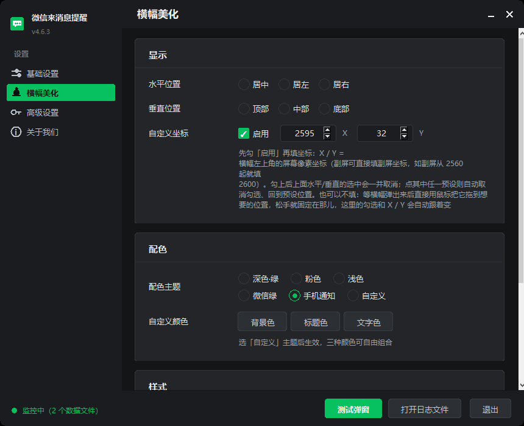

# 微信提醒 · 横幅自定义坐标 +「启用」勾选 + 拖动定位置（v4.6.3）

原版「微信提醒 v4.6.1」上改了三件事：**① 横幅位置不只九宫格，还能直接填左上角的屏幕坐标 (X, Y)**，用来精确摆放，或者把横幅放到副屏 / 超宽屏的指定位置；**② 坐标行前面加了「启用」勾选框**，勾上就只认坐标、预设档位一律取消选中；**③ 横幅弹出来可以直接用鼠标拖走**，松手就固定在那儿，不用再进设置填数字。

> 上游项目：[yuz_cn/wechat-notify](https://gitee.com/yuz_cn/wechat-notify)（Gitee）
> 本仓库基于上游 v4.6.1 源码，版本号 **v4.6.3**：上游 v4.6.1 + 下面 15 处改动，其余代码与原版一致。



---

## 1. 为什么要改

原版的横幅位置只有两排预设：

- 水平：居中 / 居左 / 居右
- 垂直：顶部 / 中部 / 底部

两两组合出 9 个位置，边距固定 16px。想放到「第二块屏左上」「某个窗口旁边」「主屏右上角但更靠里一点」这类具体位置就做不到，只能在 9 个档位里选最接近的。

这个版本加了「自定义坐标」：填 X / Y 就等于把横幅**左上角**钉在那个像素点上。

## 2. 怎么用

设置 → 左栏「横幅美化」→「显示」卡片 → 最下面一行：

```
水平位置   ○居中  ○居左  ○居右
垂直位置   ○顶部  ○中部  ○底部
自定义坐标  ☑启用  [ X ]  [ Y ]
```

**先勾「启用」再填坐标**：

- 勾上「启用」= 坐标说了算，上面「水平位置 / 垂直位置」六个档位自动全部取消选中（避免"看着选了居中、其实按 X 走"）。
- 取消勾选 = 回到上一次选过的九宫格档位。
- 反过来，直接点任意一个预设档位（居中/居左/居右、顶部/中部/底部）会自动取消「启用」勾选，预设立即生效。
- 直接改 X / Y 数值也会自动勾上「启用」。

**懒得填数字就拖一下**：

- 等横幅弹出来，按住它往想放的地方拖，松手就把当前位置固定下来（写进配置，下一屏横幅还落在同一处）。
- 拖完不用回设置页：「启用」会自动勾上，X / Y 也同步成刚拖到的地方。
- 坐标是"从主屏左上角算起的正数"：副屏在主屏右边可以拖过去；拖到主屏左边 / 上方的屏算负坐标，这版不保存（只提示，下一次还回原处）。

- 单位是**屏幕物理像素**，原点是主屏左上角 `(0, 0)`，向右向下为正，和系统「显示设置」里的分辨率是同一套数值。
- 多屏时坐标是接着主屏累加的。比如主屏 2560 宽，副屏就从 `x = 2560` 开始；填 `X=2600 Y=150` 就是副屏左上往右 40、往下 150。
- 改完立即生效并写入配置，不需要重启。
- 想回到九宫格：点「居中 / 居左 / 居右」或「顶部 / 中部 / 底部」任意一档即可，坐标输入框里的数值会保留，但不再生效。

配置文件在 `%APPDATA%\微信提醒\config.json`，对应三个键：

```json
"banner_pos": "custom",
"banner_pos_x": 2600,
"banner_pos_y": 150
```

`banner_pos` 为 `custom` 时，X / Y 生效并忽略 `banner_vertical`；改成 `center` / `left` / `right` 就恢复九宫格。

### 坐标的几个注意点

- X / Y 指的是横幅**左上角**，不是中心。
- 横幅高度会随消息内容行长变化（1~3 行，约 64~140px），所以 Y 固定的是**顶部那条边**，内容变长时横幅往下延伸。
- 数值不做上限截断（副屏坐标才放得出去），填到屏幕外就看不见，改小即可。
- 若系统缩放不是 100%：程序用的 Tk 坐标系会跟着缩放走，这时屏幕坐标与填进去的数值可能差一个倍数。**先在 100% 缩放或按比例换算后再填**（见下节「已知限制」）。

## 3. 两种用法

### 方式 A：直接用改过的源码跑

要求 Python 3.13（与官方 exe 内置版本一致），依赖：

```bash
pip install pycryptodome zstandard pystray pillow
python wechat_notify.py
```

首次运行会自己找微信数据目录、提取数据库密钥，配置写在 `%APPDATA%\微信提醒\`。

### 方式 B：注入回官方 exe（保持单文件，推荐）

官方 exe 是 PyInstaller onefile 打包的：归档里主模块那一条存的是 zlib 压缩后的 marshal
code object。所以不必重新打包，把新代码编译好、追加进归档、改掉目录里那一条的偏移和长度即可，
其余 1000 多个条目一个字节都不动。

```bash
python tools/patch_exe.py --src-exe "微信提醒 v4.6.1.exe" --out-exe "微信提醒 v4.6.1 自定义位置.exe"
```

脚本会：

1. 用当前解释器编译 `wechat_notify.py`，`marshal.dumps` 成 code object；
2. 解析原 exe 的 CArchive（cookie `MEI\x0c\x0b\x0a\x0b\x0e`，目录格式 `!IIIIBc`）；
3. 把新数据追加到归档目录之后、cookie 之前，改 cookie 里的 `package_len`；
4. 重新解析生成的 exe，把主模块解出来，验证长度与改动确实写进去了。

注意：

- **编译用的 Python 必须和 exe 内置 Python 同主次版本**（本项目是 3.13），脚本会读 cookie 里的
  `pyvers` 做校验，不一致直接报错退出。
- 需要原版 exe（上游 Releases 里下载），本仓库不附带 exe 二进制。
- 生成的 exe 除主模块外与原版完全一致，图标、托盘、提示音、开机自启、单实例都不变。

验证落点（可选）：

```bash
python tools/watch_banner.py <进程PID> ...
```

脚本会枚举该进程的可见窗口，等横幅出现后打印它的屏幕矩形——用来确认「填的坐标 = 实际落点」。

## 4. 具体改了哪些地方

v4.6.3 一共 15 处，都在 `wechat_notify.py`：

### 4.1 自定义坐标（8 处）

| # | 位置 | 改动 |
|---|------|------|
| 1 | `DEFAULT_CONFIG` | 新增 `banner_pos_x` / `banner_pos_y`（默认 40），`banner_pos` 注释补充 `custom` |
| 2 | `banner_x(bw, sw)` | 增加 `custom` 分支：直接返回 `banner_pos_x`；**不做主屏宽度截断**，副屏才放得出去 |
| 3 | `banner_y(bh, sh)` | `banner_pos == "custom"` 时返回 `banner_pos_y`（优先于 `banner_vertical`） |
| 4 | `Banner._build()` | 初始几何的 y 原来写死 `16`，改为走 `banner_y()` |
| 5 | `_build_beauty()` | 「显示」卡片新增「自定义坐标」行：两个数字输入框 X / Y |
| 6 | `_build_beauty()` | custom 模式下「垂直位置」不显示选中态，避免"看着选了底部却按 Y 走"的误解 |
| 7 | 新增 `_on_pos_xy()` / `_on_vertical()` | 改 X / Y 自动切 `custom` 并立即应用；点垂直预设自动退出 `custom` |
| 8 | `_apply_banner()` | 把 X / Y 写回配置并 `save_config()` |

### 4.2 坐标「启用」勾选（4 处）

| # | 位置 | 改动 |
|---|------|------|
| 9 | `_build_beauty()` | 「自定义坐标」行最左加 `RoundedCheckbox("启用")`；水平/垂直六个 `RoundedRadio` 存进 `_radio_h` / `_radio_v`；`custom` 时两个 var 取空串（不显示选中） |
| 10 | 新增 `_on_bcustom()` / `_refresh_pos_radios()` / `_sync_custom_chk()` | 勾选时清空预设并手动重画单选圈（`RoundedRadio` 只在被点击时才刷新组，程序改 var 必须自己刷）；取消勾选恢复上次预设 |
| 11 | `_on_hpos()` / `_on_vertical()` / `_on_pos_xy()` | 点预设自动取消「启用」；改 X/Y 自动勾上「启用」 |
| 12 | `_apply_banner()` | 勾了就写 `banner_pos="custom"`，否则写预设值；`banner_vertical` 为空时不覆盖配置 |

### 4.3 拖动横幅就固定位置（3 处）

| # | 位置 | 改动 |
|---|------|------|
| 13 | `Banner._release()` | 拖过（`_moved`）就走 `_lock_pos()`；结束后清 `_moved`，避免"子控件 + 窗口"两条绑定各存一次、各打一条日志 |
| 14 | 新增 `Banner._lock_pos()` | 取 `winfo_x/y` 写成 `banner_pos="custom"` + `banner_pos_x/y` 并 `save_config()`；**负坐标不落盘**（Tk 的 geometry 只认主屏左上角起算的正数）；设置窗口开着就回调 `sync_banner_pos()` |
| 15 | 新增 `SettingsWindow.sync_banner_pos()`；`open_settings()` 里记 `banner.settings = w` | 拖完自动勾「启用」、回填 X / Y、取消水平/垂直预设（程序改 var 不会触发控件刷新，单选圈要手动重画） |

另外加了一个调试开关（不影响正常使用）：环境变量 `WXNOTIFY_START_TAB=beauty|advanced|about|basic`
可以让设置窗口启动后直接停在指定页，方便截图核对。

## 5. 已知限制

- **只支持 Windows**（Tk + Win32 API + 微信本地库解密，跟原版一致）。
- **系统缩放 ≠ 100% 时坐标可能偏移**：Tk 的 `geometry` 用的是它自己的像素坐标，进程 DPI 感知方式不同会导致与屏幕物理像素差一个缩放倍数。本机 2560×1440 @100% 实测「填 2600,150 → 实际 2600,150」完全一致；如果你开了 125%/150% 发现落点偏了，按缩放比例乘一下再填（125% 就把数值 ÷1.25）。
- 多屏坐标依赖主屏尺寸；主屏换了分辨率要重填。
- 横幅高度自适应，Y 锁的是顶边，不是底边。
- 这是个人修改版，不保证跟进上游后续版本的其它修复。

## 6. 目录结构

```
wechat_notify.py   主程序（已改）
wechat_db.py       微信数据库解密读取（原版，未改）
wecom_notify.py    企业微信弹窗 OCR 监控（原版，未改）
wx_key_engine.py   数据库密钥提取（原版，未改）
sounds/            内置提示音 wav（原版）
tools/
  patch_exe.py     把改过的源码注入 PyInstaller onefile exe
  watch_banner.py  等横幅出现并测量它的屏幕坐标（验证用）
docs/
  banner-position.png  自定义坐标界面截图
```

## 7. 授权与致谢

- 原项目：[yuz_cn/wechat-notify](https://gitee.com/yuz_cn/wechat-notify)。上游仓库**未声明开源许可证**（Gitee 页面上标的是「该仓库未声明开源许可证文件」）。
- 因此本仓库同样不附加任何许可证，仅作为学习交流用的个人修改版本；转载 / 分发请先确认上游作者的意愿，并保留原项目出处。
- 若原作者认为本仓库不妥，删除即可，无需另行通知。
